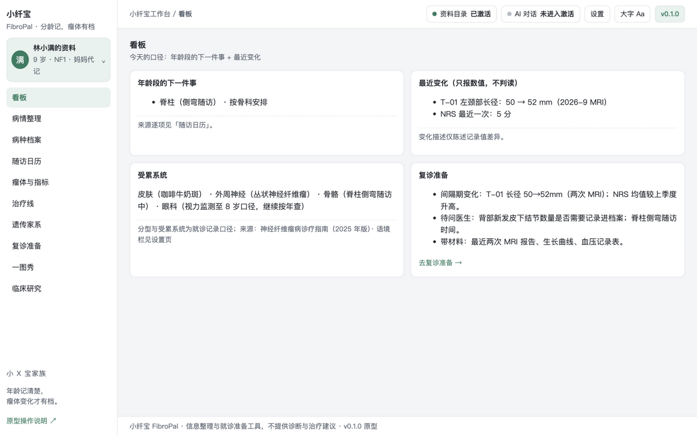
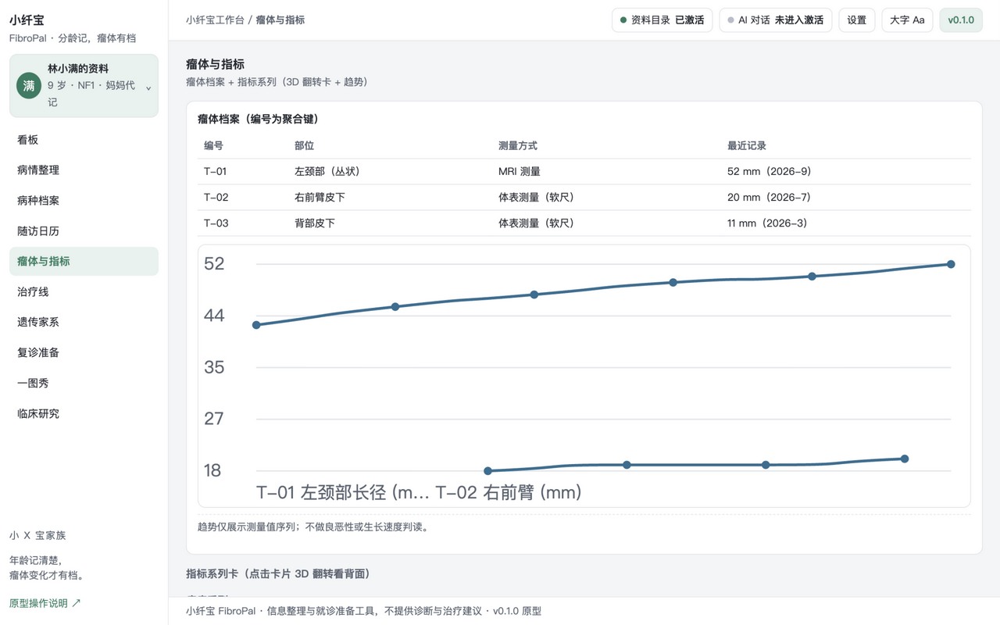
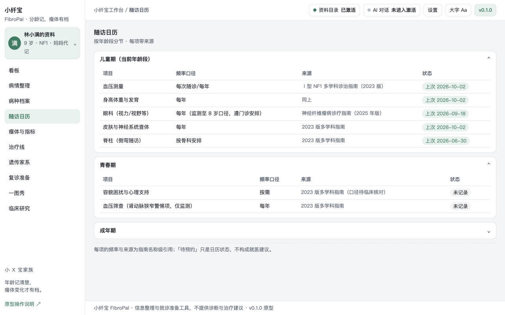
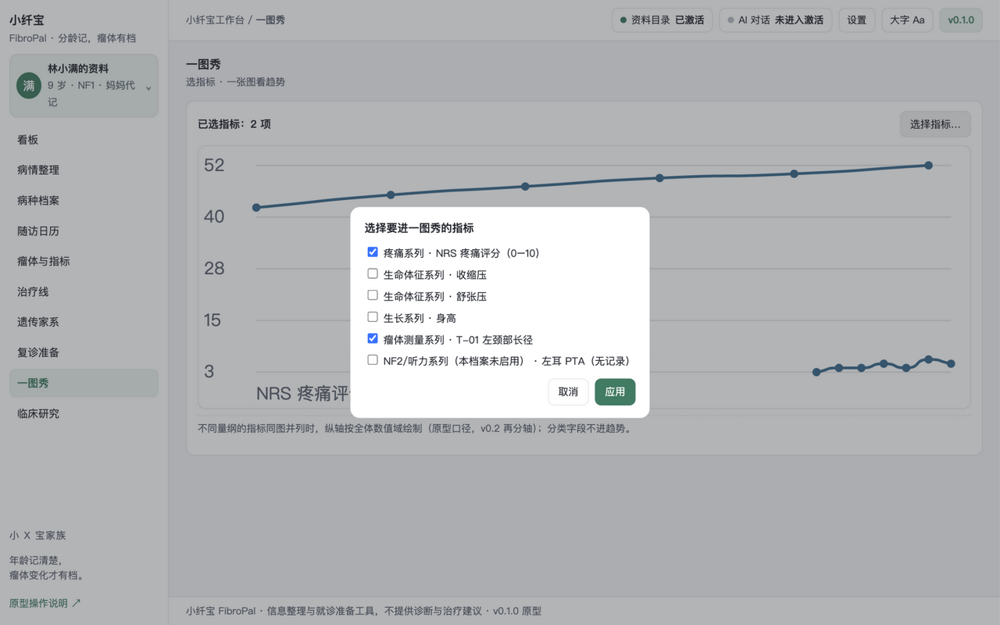
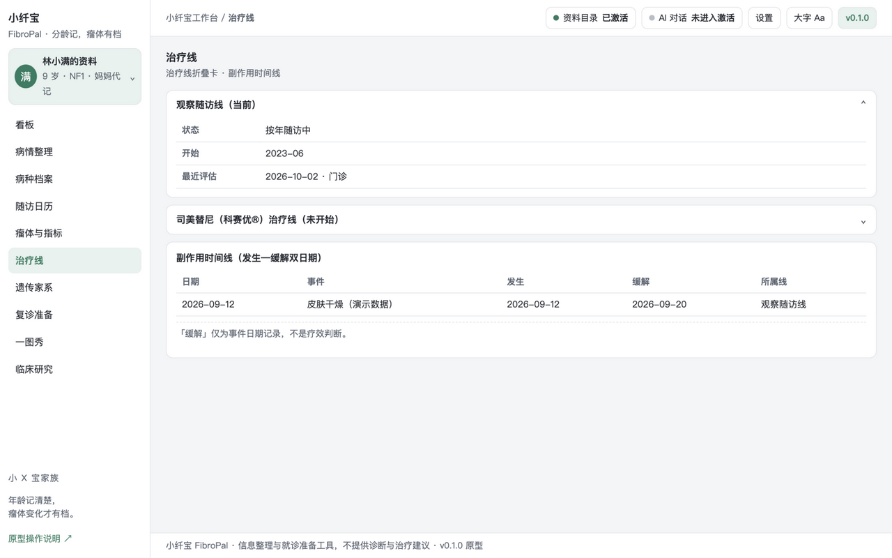
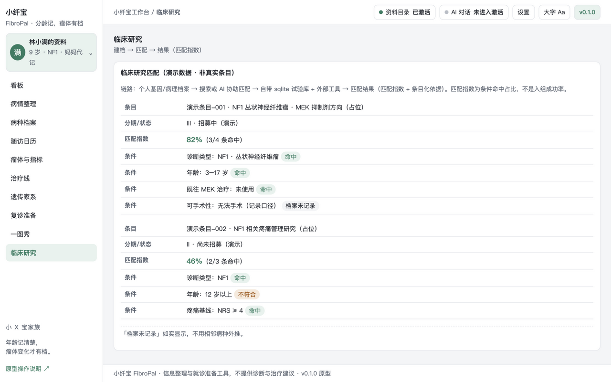

# 小纤宝 FibroPal 神经纤维瘤病工作台

本机优先的神经纤维瘤病（NF1/NF2相关施万细胞瘤病/施万细胞瘤病）终身随访、瘤体档案、疼痛与听力记录、MEK抑制剂治疗线与遗传咨询准备工作台

## 原型实渲截图（v0.1 · 2026-10-25 实拍）

| 看板（首屏含版本号） | 瘤体与指标 · 3D 翻转卡背面 |
| --- | --- |
|  |  |

| 随访日历 · 分龄折叠展开态 | 一图秀 · 指标选择窗口 |
| --- | --- |
|  |  |

| 治疗线折叠卡（展态） | 临床研究匹配（匹配指数+条件明细） |
| --- | --- |
|  |  |

> 指标卡为分系列有序卡片墙，点击 3D 翻转看背面（最近记录+来源）；趋势折线 SVG `class="chart"`、Fritsch–Carlson 平滑；治疗线/随访日历为折叠卡，收/展两态均为验收态；独立评审 P0=0（2026-10-25，报告见 docs/PROTOTYPE-REVIEW.md）。

这是接入骨架，尚未实现真实业务。初始化后先将 [项目设计提示词](docs/DESIGN-PROMPT.md) 交给当前Agent；它应展示实际路径并以已有用户/场景/流程素材对齐设计者、研究与取舍原则。癌种项目另有 [完整专用提示词](prompts/NEW-CANCER-WORKBENCH.md)。需求见 [BRIEF](docs/BRIEF.md)，规格见 [SPEC](docs/SPEC.md)，任务见 [TASKS](docs/TASKS.md)；先读 [AGENTS](AGENTS.md)。CLI输出交接与首问，实际对话由Agent接续。

## 开发顺序

先共创SPEC和候选数据关系，再交付HTML交互工作台；由用户确认对应版本/模块后，复核SCHEMA/API并实现生产功能。确认记录见docs/PROTOTYPE-REVIEW.md；模型不依赖前端Tab/流程。模板骨架不是业务已确认。

## 当前能力

- 一个 DSH 工作台注册、认证的健康接口、版本展示与标准/大字切换。
- 已明确选择布局：business-first。business-first 使用 customFrame；模板不创建会话或复制聊天。需要 AI 协助时按官方合同接入原生 conversation 和会话管理。
- 无业务数据库、无演示患者、无真实密钥；所有业务页按确认 spec 逐项实现。

## 开发与本地验收

需要 Node.js 22+、Git、包管理器和可用 DSH Desktop；采用 SQLite 时另核验 node:sqlite 版本条件。宿主 peers 的范围仅是模板基线，请与目标 Desktop 实际依赖核对。

```bash
npm install
npm run check
npm run pack:check
npm pack
```

`npm run check` 只保证"能装"（语法 + 装包合同），第一天就该是绿的。`npm run audit` 管"还是不是家族里的一员"：版本三处一致、`lib/layout.js` 面板参数单一来源、检查链完整、文档与密钥卫生，**只看代码与文件，不看文档自述**。新项目刚生成时 audit 必然有 fail，那是待办清单；交付/发布前必须清零，存在 fail 不得发布（`npm run release:check` 一次跑完两者）。

跑的时间点：**每次改完**跑 `check`；**G2 原型确认后、写业务代码前**先跑一次 `audit`（这时缺的多是 `lib/layout.js`、`VERSION` 这类结构，越早补越便宜）；**交付/装机前**必须跑 `release:check`；**发布或投稿前**把 `npm run audit --json` 的 `xx/xx 通过 · N 失败 · M 待人工` 抄进 `docs/RELEASE.md` 的「家族一致性」一行。`✗` 是结构缺口（补齐，或在 `docs/DEV-REQUIREMENTS-<日期>.md` 写明偏离理由并由用户确认），`!` 是需人工判断的项（逐条给「已人工确认 / 确实没有」）。

`npm install` 可能按 npm 策略解析 peer；勿为消警告重复打包宿主 runtime。客户端本身是单文件；引入 TS/组件库后需添加构建步骤并保留单文件导出。

本地安装入口以当前 Desktop/CLI 帮助为准。安装后按 [docs/06-VALIDATION-AND-RELEASE.md](docs/06-VALIDATION-AND-RELEASE.md) 与官方自测完成真实 UI 验收，并填写 [docs/ACCEPTANCE.md](docs/ACCEPTANCE.md)。静态检查不代表已加载。

Logo 来源与使用限制见 assets/README.md。许可证、作者、仓库/发布策略由本项目维护者确认后填写；模板默认为 private/UNLICENSED。

感谢小x宝社区、DataElement 社区，以及 sam / hhx / 繁华的 ❤️ 贡献。

初始化来源记录见 `.dsh-wb-starter.json`。更新社区脚手架不会覆盖本项目；需要升级时先用相同确认配置在临时目录生成，再审阅差异。CLI 用法见 [docs/CLI-GIT.md](docs/CLI-GIT.md)。

## HTML先行与数据演进

业务开发前先交付HTML交互工作台原型、实际预览并由用户确认版本/hash和范围。数据设计先区分领域事实、流程状态和页面读模型，走查前端/流程变化、兼容与迁移；原型对象不直接作为表。见[规范](docs/14-HTML-AND-DATA-CONTRACT.md)。
